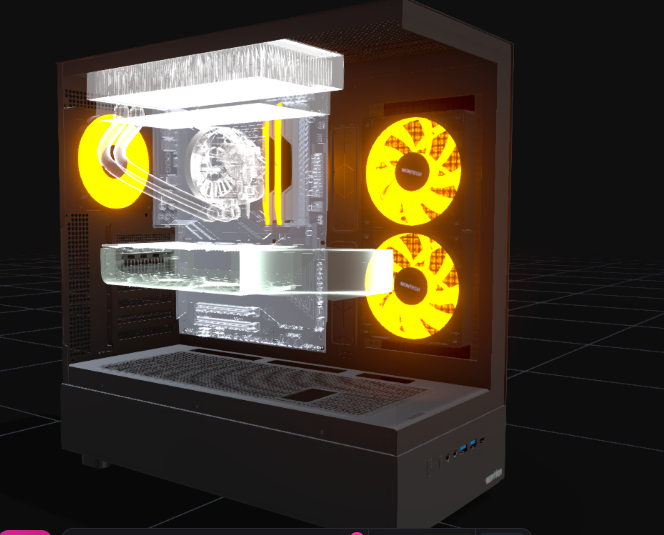

## Role description

3D Visualisation Specialists render scenes, work with large models and high-resolution textures, produce media output and present visuals to clients. They put the heaviest sustained load on the GPU, CPU, memory and storage, and need an accurate display.

| **Hardware** | **Chosen item/specification** | **Cost** | **Basis** | **Justification** |
| --- | --- | --- | --- | --- |
| CPU | AMD Ryzen 9 9900X (12 cores / 24 threads) | £339 | Listing | Rendering and scene preparation scale well with extra cores, and CPU renderers benefit most. 12 cores give a large step up from the CAD build without moving to expensive workstation platforms. |
| Motherboard | B650 ATX board, 4 DIMM slots, PCIe 4.0 x16, 2 x M.2, 2.5GbE | £150 | Estimate | Full-size board with robust power delivery for a 120W CPU and room for extra storage; four slots support 64GB or more. |
| RAM | 64GB (2x32GB) DDR5-6000 | £565 | Listing | Large scenes, high-resolution textures and several applications open at once can exceed 32GB. 64GB avoids slow disk swapping. |
| Storage | 2TB NVMe Gen4 SSD with DRAM cache | £270 | Estimate | Texture libraries, scene files and rendered output are large; 2TB gives working space, with a second M.2 slot for later expansion. |
| GPU | NVIDIA GeForce RTX 5080 16GB | £1,290 | Listing | Real-time renderers and GPU ray tracing depend most on the graphics card, so the largest share of this budget goes here. It is the main reason this build costs more than the CAD build. |
| PSU | 850W 80+ Gold ATX PSU | £115 | Estimate | The RTX 5080 draws around 360W by itself, so the PSU must have headroom for transient spikes and reliability. |
| Case/cooling | ATX high-airflow case (£85) + 240mm all-in-one liquid cooler (£70) | £155 | Estimate | Sustained rendering keeps CPU and GPU at full load for hours; strong cooling avoids throttling and extends component life. |
| Monitor(s) | 27-inch 4K IPS, factory-calibrated, ~99% sRGB (£340) + 24-inch 1080p IPS second screen (£95) | £435 | Estimate | Colour accuracy and resolution matter for judging renders before showing clients. A dedicated 4K screen is a more affordable choice than a top-end reference display. |
| Keyboard | Full-size mechanical/quality keyboard | £40 | Estimate | Comfortable for heavy daily use. |
| Mouse | Precision wireless mouse | £35 | Estimate | Accurate control when navigating 3D scenes. |
| Webcam/Headset | 1080p webcam (£55) + headset (£60) | £115 | Estimate | Client presentations are often delivered remotely. |
| Network/Cables/Adapters | 2 x DisplayPort 1.4 cables (£12 each) + 2m Cat6 cable | £29 | Estimate | 4K at high refresh needs DisplayPort 1.4; wired network for moving large assets. |
| **Total hardware workstation cost** |  | **£3,538** |  |  |
| **Role hardware budget (per workstation)** |  | **£3,750** |  |  |
| **Under/over hardware budget** |  | **Under £212** |  |  |

**Role total:** 2 × £3,538 = £7,076 against a role budget of £7,500 (under £424).

**BuildCores base unit (3D view)**

